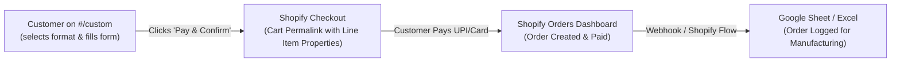
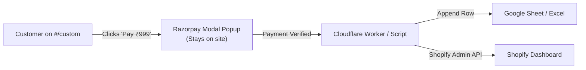

# Ideation: Custom Design Order Backend, Dynamic Pricing & Fulfillment Flow

## Grounding Context
- The PastForward site is a static single-page application built into `docs/index.html` with vanilla JS modules (`src/routes.js`, `src/core.js`, `src/boot.js`).
- The current `#/custom` route (`viewCustom()` in `src/routes.js`) renders a contact form (`name`, `email`, `whatsapp`, `format`, `artist`, `album`, `ref`, `notes`) with an interactive label preview (`mountCustom()`).
- Currently, submitting the form calls `submitForm('custom', payload)` in `src/core.js`, which is a client-side stub returning `Promise.resolve({ ok: true })`.
- The user wants upfront payment before making the item, with price matching format:
  - Vinyl: ₹999
  - A3 Poster: ₹299
  - 10×10 Format: ₹249
  - A5 Poster: ₹199
  - Polaroid: ₹99
- Captured orders must land in:
  1. An Excel Sheet / Google Sheet (instant spreadsheet logging for manufacturing/tracking).
  2. The Shopify Dashboard (centralized order management, fulfillment, and customer notifications).

## Topic Axes
- Axis 1: Checkout & Payment Experience (In-app modal vs. Shopify native checkout redirect)
- Axis 2: Data Pipeline & Synchronization (Direct API vs. Webhook automation vs. Shopify Line Item Properties)
- Axis 3: Frontend Dynamic Pricing & Form Interactivity (Live price updates & validation)

---

## Ranked Ideas

### 1. Shopify Cart Permalink with Custom Line Item Properties & Shopify Flow
**Description:**
Configure a "Custom Album Artwork" product in Shopify with variants for each format (Vinyl @ ₹999, A3 @ ₹299, 10×10 @ ₹249, A5 @ ₹199, Polaroid @ ₹99). On the PastForward `#/custom` page, as the user selects the format, update the UI to display the exact price. When the user clicks "Pay & Confirm", the frontend constructs a Shopify Cart Permalink containing the variant ID and custom Line Item Properties (Artist, Album, Reference Link, WhatsApp Number, Notes). The user checks out via Shopify's standard checkout (UPI, Cards, Netbanking). Once paid, Shopify automatically records the order, and Shopify Flow (or the official Google Sheets app for Shopify) instantly appends a new row with all custom fields into an Excel/Google Sheet.

- **Axis:** Checkout & Payment Experience / Data Pipeline
- **Basis:** `direct:` Shopify's Cart Permalink API supports `attributes` and `properties` out-of-the-box (`/cart/{variant_id}:1?properties[Artist]=...&properties[WhatsApp]=...`).
- **Rationale:** 100% serverless. PastForward doesn't need to build, host, or secure a custom backend or manage PCI-DSS payment compliance. Shopify natively handles UPI, GST invoices, abandoned cart emails, customer order notifications, and dashboard tracking.
- **Downsides:** Brief redirect to your Shopify checkout domain.
- **Confidence:** 95%
- **Complexity:** Low

---

### 2. Embedded Razorpay Standard Checkout + Cloudflare Worker (or Google Apps Script)
**Description:**
Integrate Razorpay's Standard Checkout Modal directly on `#/custom`. When the user selects a format, the button reflects the live price (e.g. `Pay ₹999 & Confirm Order`). When clicked, the frontend validates the form and opens the Razorpay modal directly over the PastForward page (UPI QR code, GPay, PhonePe, Cards). On payment success, the frontend sends the Razorpay Payment ID + form details to a lightweight serverless endpoint (Cloudflare Worker or Google Apps Script Web App), which:
1. Appends a row to the Google Sheet (Excel-compatible).
2. Uses Shopify Admin API (`POST /admin/api/2024-01/orders.json`) to create a Paid Order in Shopify with financial status `paid`.

- **Axis:** Checkout & Payment Experience / In-Site Native Flow
- **Basis:** `external:` Standard headless e-commerce pattern with Razorpay checkout + serverless order ingestion.
- **Rationale:** The customer never leaves the custom design experience on `pastforward.shop`. Razorpay fees in India (~2%) are lower than international gateway charges, and UPI conversion rates are exceptionally high.
- **Downsides:** Requires hosting a lightweight serverless webhook (e.g. free Cloudflare Worker) to securely verify payment signatures with the secret key and talk to Shopify's API.
- **Confidence:** 90%
- **Complexity:** Medium

---

### 3. Google Apps Script Web App Endpoint + Payment Link Redirection
**Description:**
Write a zero-cost Google Apps Script attached directly to your Google Sheet that exposes a `doPost(e)` endpoint. When the user fills out the form on `#/custom`, `submitForm` posts the JSON data to Google Apps Script. Google Apps Script adds the row immediately with status `Payment Pending`, then generates a payment link (via Razorpay or Cashfree API) and returns the URL. The client redirects to pay, and a payment webhook updates the sheet row to `Confirmed`.

- **Axis:** Data Pipeline & Synchronization
- **Basis:** `reasoned:` Google Apps Script requires zero hosting setup and connects natively to Google Sheets.
- **Rationale:** Completely free, requires no servers or build tools.
- **Downsides:** Multi-step asynchronous handshake can result in dropped orders if the user closes before the payment link opens.
- **Confidence:** 75%
- **Complexity:** Medium

---

## Rejection Summary

| # | Idea | Reason Rejected |
|---|------|-----------------|
| 1 | Pure Formspree / Email-only submission | Rejected: Does not collect payment upfront; leaves orders unconfirmed and requires manual follow-up. |
| 2 | Full custom Node.js Express server with database | Rejected: PastForward is currently a static Jamstack frontend; introducing a full dedicated backend server introduces server maintenance, uptime monitoring, and unnecessary operational costs. |
| 3 | Cash on Delivery (COD) for custom designs | Rejected: High RTO risk for customized merchandise that cannot be resold if rejected upon delivery. |
